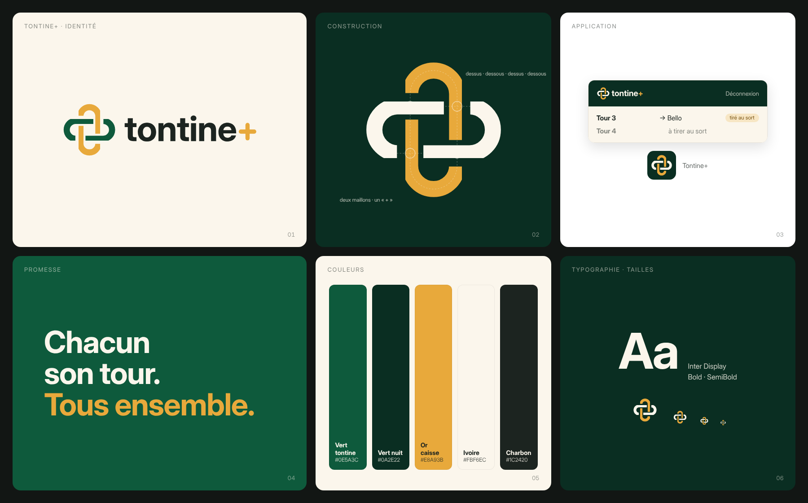

# Identité visuelle TONTINE+



## L'idée

Le symbole, **la calebasse**, est la caisse commune de la tontine : une calebasse en terre cuite,
gravée d'une frise en zigzag, dans laquelle une **pièce d'or** vient d'être déposée.

- la **calebasse** est l'objet qu'on se passe de main en main dans les réunions : elle dit la
  confiance et la tradition ;
- la **pièce** qui passe derrière le rebord, c'est la cotisation de chacun qui entre dans la caisse ;
- la **frise** rappelle les motifs gravés des calebasses et des poteries d'Afrique centrale.

Le « + » ocre du nom fait écho à la pièce. Promesse : **Chacun son tour. Tous ensemble.**

## Fichiers

| Fichier | Usage |
| --- | --- |
| `svg/logo-horizontal.svg` | Logo principal sur fond clair |
| `svg/logo-horizontal-blanc.svg` | Logo sur fond brun nuit ou photo sombre |
| `svg/symbole.svg`, `svg/symbole-blanc.svg` | Symbole seul (avatar, tampon, petit espace) |
| `svg/mot-symbole.svg` | Nom seul |
| `svg/icone-app.svg`, `png/icone-*.png` | Icône d'application (coins arrondis) |
| `svg/icone-carree.svg`, `png/apple-touch-icon.png`, `png/icone-maskable-512.png` | Icône pleine pour iOS et Android (le système arrondit lui-même) |
| `svg/favicon.svg`, `png/favicon-32.png` | Onglet du navigateur |

Tous les SVG ont le texte **vectorisé** : ils s'affichent à l'identique sans police installée.
Préférez toujours le SVG ; les PNG servent quand le SVG n'est pas accepté.

## Couleurs

| Nom | Hex | Rôle |
| --- | --- | --- |
| Terre cuite | `#9A4322` | Couleur principale, boutons, la calebasse |
| Brun nuit | `#5A2614` | Fonds sombres, barre de navigation |
| Ocre | `#E9A23B` | Accent unique : la pièce, le « + », le tour tiré ; jamais en grand aplat de texte |
| Crème | `#F6EBDD` | Fond des pages, logo sur fond sombre |
| Brun | `#3B2A20` | Texte, nom dans le logo |

## Déclinaisons

Dans `declinaisons/`, des modèles HTML modifiables et leur rendu PNG (`declinaisons/png/`) :

| Modèle | Format | Usage |
| --- | --- | --- |
| `carte-membre.html` | 85,6 × 54 mm (format carte bancaire), rendu 2× | Carte remise à chaque membre |
| `recu-cotisation.html` | 800 × 1120, rendu 2× | Reçu de paiement, à imprimer ou à envoyer |
| `post-reseaux.html` | 1080 × 1080 | Publication Facebook / Instagram |
| `statut-whatsapp.html` | 1080 × 1920 | Statut WhatsApp, story |
| `partage.html` | 1200 × 630 | Aperçu des liens partagés (copié dans `frontend/public/partage.png`) |

Pour modifier un texte, éditez le fichier HTML. Relancez ensuite `node declinaisons/rendre.cjs`
(il faut `playwright-core` et Chromium). Les données affichées (Awa Ndongo, montants) sont des exemples.

## Animation d'ouverture

`svg/ouverture.svg` (aperçus : `ouverture.mp4`, et la démo dans un téléphone, voir plus bas) se joue à chaque ouverture de l'appli, en 3 s :

1. La calebasse prend son élan et **bascule** : elle roule sur son fond arrondi jusqu'à poser le rebord.
2. La **pièce** en sort, tombe et **roule** vers la droite.
3. Le **nom apparaît au fur et à mesure** derrière la pièce, comme si elle le déroulait.
4. Arrivée au bout, la pièce **devient le « + »**, et la calebasse se redresse : on retrouve le logo.

Le SVG anime tout lui-même, sans script ni bibliothèque, et ne pèse que 5 Ko. Dans l'appli, un toucher
passe l'animation. Elle n'est pas jouée si l'appareil demande de réduire les animations. Ensuite,
tant que la session se charge, l'**écran de démarrage** montre la calebasse qui flotte doucement.

Démo de 9 s au format vertical, pour WhatsApp ou une présentation :

- `ouverture-demo.mp4` : avec narration, musique façon balafon et bruitages (la calebasse qui
  bascule, la pièce qui tinte et roule, un carillon quand elle devient le « + ») ;
- `ouverture-demo-musique.mp4` : la même, sans la voix.

La musique et les bruitages sont synthétisés : aucun extrait sonore tiers. La voix est générée par
[Piper](https://github.com/rhasspy/piper) avec la voix française « siwis », entraînée sur le corpus
SIWIS (Université d'Édimbourg, licence CC BY 4.0). Mentionnez-le si vous diffusez la version narrée.

## Typographie

Le nom est dessiné à partir de **Caladea Bold**, une serif chaleureuse (licence SIL Open Font
License). Les titres de l'appli l'utilisent aussi : elle est embarquée en woff2, réduite aux
caractères latins, dans `frontend/src/fonts/`. Le reste de l'interface garde la police système,
plus lisible en petit.

## Règles

- Zone de protection autour du logo : au moins le diamètre de la pièce.
- Taille minimale : symbole 16 px, logo horizontal 24 px de haut.
- Ne pas changer les couleurs du symbole, ne pas le déformer, ne pas sortir la pièce de la calebasse.
- Sur fond clair : version couleur. Sur fond sombre : version blanche (calebasse crème, la pièce reste ocre).

## Régénérer

`generer_logo.py` produit tous les SVG (Python 3 + `fonttools`, police Caladea installée) :

```sh
python generer_logo.py svg/
```
